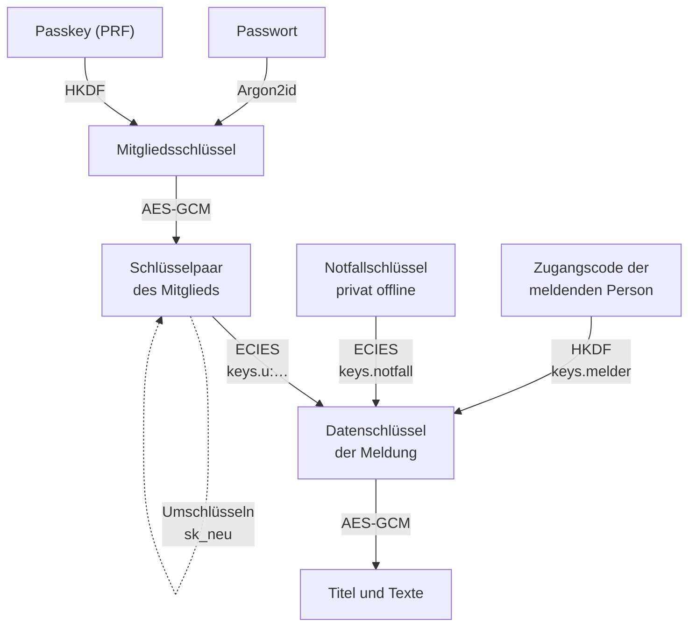

# Sicherheit

Ein Meldeportal nach HinSchG muss zweierlei schützen: die Identität der meldenden Personen und den Inhalt ihrer Meldungen. Dieses Dokument beschreibt, wie das Portal beides tut, wo die Grenzen liegen und wie man Sicherheitslücken meldet. Den größten Teil nimmt die Verschlüsselung ein, weil ihre Verfahren begründet sein wollen.

## Schutzmaßnahmen im Überblick

- **Anonymität:** Das Portal speichert keine IP-Adressen und bindet keine Dienste Dritter ein, auch kein CAPTCHA. Die meldende Person erreicht ihre Meldung allein über ihren Zugangscode.
- **Automatisierte Meldungen:** Drosselung im Webserver, ein signierter Zeitstempel im Formular, ein Köderfeld und eine Obergrenze je Portal (README, „Schutz vor automatisierten Meldungen“).
- **Anmeldung des Teams:** Passwort mit zweitem Faktor oder ein Passkey; Fehlversuche verlängern die Wartezeit. Neue Zugänge und vergessene Passwörter brauchen die Freigabe durch ein anderes Mitglied, ein übernommenes Postfach allein öffnet also keine Meldung. Rollen begrenzen, wer welche Meldungen sieht.
- **Verschlüsselung:** Titel und Nachrichtentexte liegen verschlüsselt auf dem Server (siehe unten).
- **Anfragen fremder Seiten:** Formulare im Team-Bereich prüfen die Herkunft der Anfrage; Sitzungscookies sind `SameSite=Strict`.
- **Löschen:** Im Portal braucht eine Löschung zwei Personen, außer bei Test-Meldungen (eine Person, das übrige Team erhält eine Mail); der Fristen-Wächter löscht Meldungen 3 Jahre nach Abschluss, mit Ankündigung an das Team.

Anmeldung im Portal und Verschlüsselung gelten für Portale mit `"Anmeldung": "portal"` (README, „Anmeldung und Verschlüsselung“). Code: `portal/common/crypto.php`, `portal/common/auth.php`, `portal/team/webauthn.php`.

## Betrieb

Die Software allein reicht nicht: Wer den Server betreibt, entscheidet mit, ob Anonymität und Verschlüsselung halten.

### Nötig

- **Webserver nach der Vorlage** `scripts/nginx-portal.example.conf`: nur `portal/` als Document Root, Meldungen, Benutzerdateien und `passwd` darüber und damit außerhalb; keine Zugriffsprotokolle und kein Fehlerprotokoll mit IP-Adressen, sonst ist die Anonymität dahin; Drosselung eingebunden. PHP-Fehler in ein eigenes Protokoll des PHP-Pools.
- **HTTPS** mit gültigem Zertifikat, HTTP nur zur Umleitung.
- **Notfallschlüssel** offline erzeugen (`scripts/emergency.php --neu`), den privaten Teil an mindestens zwei getrennten Orten offline verwahren, `emergency.pub` installieren. Ohne ihn ist ein Portal mit Portal-Anmeldung gesperrt, nur Startseite und Datenschutzhinweise bleiben erreichbar.
- **Dateirechte:** Die Daten eines Portals gehören dem Benutzer seines PHP-Pools und sind nur für ihn lesbar; das Portal legt seine Dateien so an. Ausnahme ist `passwd` (0640): Der Webserver liest sie über die Gruppe für die Anmeldung. Mit einem eigenen Pool je Portal kann ein angreifbares Portal die anderen nicht lesen.
- **Zeit** per NTP synchron halten: TOTP-Codes, Mail-Links und Sitzungsdauer hängen an der Uhr.
- **Mailversand,** der zuverlässig zustellt (sendmail-kompatibel, mit SPF und DKIM): Anmeldecodes, Freigaben und Fristen kommen per Mail.
- **Fristen-Wächter** täglich laufen lassen (README, „Fristen-Wächter“); er löscht nach den Fristen des HinSchG.
- **Updates** für Betriebssystem, Webserver, PHP und OpenSSL zeitnah einspielen.
- **Datensicherung** mit begrenzter Aufbewahrung, wie in den Datenschutzhinweisen angegeben, und mit Zugriffsschutz. Sie enthält die lesbaren Angaben (Risiko 2) und die Benutzerdateien, gehört also nicht in fremde Hände.

### Sinnvoll (Härtung)

- **Abschottung:** die Portale auf einem eigenen Server, einer eigenen VM oder in einem eigenen Container mit möglichst wenigen weiteren Diensten; mindestens ein eigener PHP-FPM-Pool mit eigenem Benutzer, `open_basedir` und eigenem Sitzungsordner (Risiko 4).
- **Zugang zum Server:** SSH nur mit Schlüssel, kein Root-Login; eine Firewall lässt nur HTTPS, HTTP und SSH durch.
- **Sicherheits-Header:** eine Content-Security-Policy, die nur eigene Skripte zulässt und das Einbetten verbietet (`frame-ancestors 'none'`), dazu `X-Content-Type-Options: nosniff`, `Referrer-Policy: no-referrer` und HSTS; TLS-Einstellungen nach BSI TR-02102-2.
- **Integritätsprüfung:** Programmdateien und Portal-Code regelmäßig gegen einen bekannten Stand prüfen (etwa mit AIDE oder den Prüfsummen des Paketmanagers) und bei Abweichung alarmieren.
- **Überwachung:** Erreichbarkeit, Laufzeit des Zertifikats, Fehlerprotokolle und den täglichen Lauf des Fristen-Wächters.
- **Sicherungen** verschlüsselt und an einem zweiten Ort.
- **Festplattenverschlüsselung** des Servers, gegen Diebstahl der Hardware.
- **Team-Bereich** auf bekannte Netze oder ein VPN beschränken, wenn das Team damit leben kann – nie das Meldeformular.

## Verschlüsselung

### Was sie leistet

Sie schützt gespeicherte Meldungen: Wer die Dateien eines Portals liest – aus einer Sicherung, einer kopierten Platte, als Administrator des Servers ohne Zugang zum Portal –, sieht Titel und Nachrichtentexte nicht. Lesen kann nur, wer einen der Schlüssel hat, für die eine Kopie des Datenschlüssels der Meldung vorliegt.

Sie schützt nicht vor einem Angreifer, der den laufenden Server übernimmt: Der Server verschlüsselt und entschlüsselt selbst, er sieht Passwörter bei der Anmeldung und Texte beim Absenden und Lesen. Dagegen hülfe nur, im Browser zu verschlüsseln – und auch das nur, wenn der Code dafür nicht vom selben Server kommt (siehe Risiko 1).

### Übersicht

Das Portal arbeitet nach dem Umschlagverfahren (Envelope Encryption): Jede Meldung hat einen eigenen **Datenschlüssel**, der Titel und Texte verschlüsselt. Dieser Datenschlüssel liegt nicht im Klartext vor, sondern als **Schlüsselkopie** je berechtigter Stelle – für die meldende Person, für jedes berechtigte Mitglied und für den Notfallschlüssel des Betreibers –, jeweils mit deren eigenem Schlüssel verschlüsselt.

Jeder Pfeil heißt: Mit dem Schlüssel links lässt sich öffnen, was rechts steht; am Pfeil stehen Verfahren und Feld in der Datei. Passwort, Passkey-Geheimnis und Zugangscode werden nicht gespeichert (vom Passwort nur ein Argon2id-Hash, vom Zugangscode ein Prüfwert); der Server hält Schlüssel nur während einer Anfrage oder verschlüsselt in der Sitzung. Lesbar ohne Schlüssel bleiben ID, Status, Daten und Aktionen (Risiko 2).

### Verfahren und warum

Maßstab ist die [BSI TR-02102-1](https://bsi.bund.de/dok/TR-02102-en) „Kryptographische Verfahren: Empfehlungen und Schlüssellängen“, Version 2026-01. Sie strebt ein Sicherheitsniveau von mindestens 120 Bit an (Abschnitt 1.1) und empfiehlt für Neuentwicklungen bestimmte Verfahren. Ihre Liste ist nicht abschließend: Nicht genannte Verfahren hält das BSI „nicht zwangsläufig“ für unsicher (Kapitel 1). Das Portal nutzt trotzdem nur genannte Verfahren, damit sich die Wahl ohne eigene Begründung belegen lässt. Alle Verfahren stecken in `crypto.php` und `auth.php`; verschlüsselte Meldungen tragen im Feld `crypto` die Kennung des Verfahrenssatzes (`tr02102-2026`), damit ein späterer Wechsel – etwa zu hybriden Post-Quanten-Verfahren – alte Meldungen findet und mit dem Notfallschlüssel umschlüsseln kann.

#### AES-256-GCM

**Gilt für:** Titel und Nachrichtentexte jeder Meldung (mit ihrem Datenschlüssel, 32 Byte Zufall), die Schlüsselkopie der meldenden Person, den Mitgliedsschlüssel (geschützt mit Passwort oder Passkey) und mit ihm das Schlüsselpaar jedes Mitglieds, Schlüsselpaar und Mitgliedsschlüssel in der Sitzung und den symmetrischen Teil von ECIES.

AES ist die einzige Blockchiffre, die die TR empfiehlt (Tabelle 3.1); GCM gehört zu den empfohlenen Betriebsarten mit Datenauthentisierung (Tabelle 3.2), verschlüsselt also und erkennt zugleich jede Veränderung (Bemerkung 3.1). Der 256-Bit-Schlüssel liegt über der Mindestlänge von 128 Bit (Tabelle 1.2). Die TR verlangt für GCM 96-Bit-Initialisierungsvektoren, Prüfsummen von mindestens 96 Bit und eine Wahrscheinlichkeit für eine IV-Wiederholung unter einem Schlüssel von höchstens 2⁻³², also höchstens 2³² Aufrufe je Schlüssel (Abschnitt 3.1.2). Das Portal nimmt zufällige 96-Bit-IVs und 128-Bit-Prüfsummen; jeder Schlüssel verschlüsselt höchstens einige hundert Texte, eine Meldung mit ihrem Verlauf. Die TR zieht deterministische IVs vor, „falls möglich“ – dafür bräuchte jeder Schlüssel einen Zähler, der über alle PHP-Prozesse hinweg nie zurückspringt; bei so wenigen Aufrufen ist Zufall innerhalb der Grenze sicherer als ein solcher Zustand. Umsetzung: OpenSSL über `openssl_encrypt`.

**Alternative XSalsa20-Poly1305** (libsodium `crypto_secretbox`, bis 18.11.2026 im Einsatz): Vorteile – 192-Bit-Nonce, zufällige Nonces sind damit praktisch unbegrenzt sicher, während eine IV-Wiederholung bei GCM Vertraulichkeit und Integrität kostet; ohne AES-Befehle im Prozessor ohne Timing-Lecks und schneller; schwer falsch zu benutzen. Nachteile – nicht in der TR, nicht von NIST standardisiert; für den Nachweis „nach BSI TR“ bräuchte es eine eigene Begründung. Bei den hier anfallenden Mengen ist der Sicherheitsunterschied ohne Bedeutung.

#### ECIES mit brainpoolP384r1

**Gilt für:** die Schlüsselkopien für jedes Mitglied (`keys.u:<Fingerabdruck>`) und für den Notfallschlüssel (`keys.notfall`).

So kann jeder, der einen öffentlichen Schlüssel kennt, für dessen Inhaber verschlüsseln – auch wenn dieser nicht angemeldet ist. ECIES ist das empfohlene hybride Verschlüsselungsverfahren auf elliptischen Kurven (Abschnitt 2.3.4, Tabelle 2.2, Schlüssellänge mindestens 250 Bit). Die TR empfiehlt Kurven mit nachweisbar zufällig erzeugten, nachvollziehbar dokumentierten Parametern und nennt Brainpool als Beispiel (Bemerkung 2.7); Tabelle B.3 führt brainpoolP256r1, P320r1, P384r1 und P512r1. Alle vier sind gleich gebaut (RFC 5639) – Primzahlordnung, Kofaktor 1, also keine kleinen Untergruppen –, an der Robustheit des Verfahrens ändert die Größe nichts, nur am Puffer gegen künftige Fortschritte der Kryptoanalyse. P256r1 erreicht etwa 125 Bit, kaum über dem Ziel; für Daten, die über den Vorhersagezeitraum der TR hinaus geschützt bleiben sollen, hält sie größere Kurven für sinnvoll (Bemerkung 2.7). P384r1 bringt etwa 190 Bit für rund 3 statt 2 Millisekunden je Schlüsselkopie (gemessen auf dem Server); P512r1 kostet 4 Millisekunden und brächte nichts mehr, weil andere Glieder – Passwörter, Zugangscode – das Gesamtniveau ohnehin bestimmen. Ablauf je Schlüsselkopie: ein frischer Wegwerf-Schlüssel, ECDH mit dem Empfänger, aus dem gemeinsamen Geheimnis HKDF-SHA256 ein AES-256-Schlüssel, dann AES-256-GCM. Die TR beschreibt ECIES mit getrennter Verschlüsselung und MAC; hier übernimmt die GCM-Prüfsumme die Rolle des MAC – die TR lässt dafür „alle empfohlenen Kombinationen aus Blockchiffre und Betriebsmodus“ zu, und GMAC ist ein empfohlener MAC (Tabelle 5.1). In die Schlüsselableitung gehen beide öffentlichen Schlüssel ein, so wie Abschnitt B.1.1 die „Bindung von Schlüsselmaterial an Protokolldaten“ beschreibt. Den Fingerabdruck eines Schlüssels bilden die ersten 16 Hex-Zeichen von SHA-256 (Tabelle 4.1) über den öffentlichen Schlüssel; er benennt nur die Schlüsselkopie und ist kein Sicherheitsmerkmal.

Grenze: Klassische Schlüsseleinigung allein empfiehlt die TR nur bis Ende 2031, danach nur noch hybrid mit einem quantensicheren KEM wie ML-KEM-768 (Abschnitt 2.3, Tabelle 2.7). PHP bietet ML-KEM derzeit nicht an; das wird jährlich geprüft (siehe „Offene Punkte zur TR“).

**Alternative X25519** (libsodium Sealed Box `crypto_box_seal`, bis 18.11.2026): Vorteile – auf sichere Umsetzung ausgelegt: jede 32-Byte-Folge ist ein gültiger öffentlicher Schlüssel, Prüfungen auf ungültige Punkte entfallen, die Rechnung läuft von Haus aus in konstanter Zeit; schnell, kurze Schlüssel; nachvollziehbar gewählte Parameter. Nachteile – nicht in der TR (die TR nennt nur Brainpool-Kurven); etwa 128 Bit, also derselbe kleine Puffer wie P256r1.

#### HKDF-SHA256

**Gilt für:** den AES-Schlüssel in ECIES, den Schlüssel für die Schlüsselkopie der meldenden Person und den Prüfwert aus ihrem Zugangscode, den Schlüssel aus der PRF-Ausgabe eines Passkeys.

HKDF ist eine der beiden empfohlenen Schlüsselableitungen (Tabelle B.1); sie beruht auf HMAC (Tabelle 5.1) mit SHA-256 (Tabelle 4.1). Je Zweck gibt es einen eigenen Kontext (`hinweise-ecies`, `hinweise-wrap`, `hinweise-check`, `hinweise-passkey`), damit kein Schlüssel für zwei Zwecke taugt. Beim Zugangscode macht ein Salz aus 32 Byte Zufall je Meldung gleiche Codes verschieden; gespeichert wird nur der Prüfwert, aus dem der Schlüssel für die Kopie nicht folgt. Eine langsame Ableitung wie Argon2id braucht es hier nicht, weil das Geheimnis zufällig erzeugt wird.

Der geheime Teil des Zugangscodes hat 16 Zeichen aus 62, etwa 95 Bit, und liegt damit bewusst unter dem Ziel der TR von 120 Bit. Die 120 Bit gelten für Schutz über Jahrzehnte; hier geht es um eine Meldung, die 3 Jahre nach Abschluss gelöscht wird, Sicherungen eingeschlossen höchstens ein Jahr später. Raten ist nur offline möglich, für jemanden, der die Datei schon hat, und kostet rund 2⁹⁴ Versuche – bei einer Billion Versuchen je Sekunde etwa 600 Millionen Jahre. Online braucht jeder Versuch eine Anfrage an den Server und ist damit noch viel langsamer. Ein längerer Code wöge schwerer: Meldende Personen müssen ihn abschreiben oder sicher aufheben, und schon 24 Zeichen sind dafür viel.

**Alternative BLAKE2b** (libsodium `crypto_generichash` mit Schlüssel und Kontext, bis 18.11.2026): Vorteile – schnell, einfach, Schlüssel und Kontext sind eingebaut, gut untersucht. Nachteile – nicht in der TR, nicht von NIST standardisiert. Sicherheitlich gleichwertig.

#### Argon2id

**Gilt für:** den Schlüssel aus dem Passwort, der den Mitgliedsschlüssel schützt (`mk.pw`), und den Passwort-Hash in `passwd`.

Ein Passwort hat zu wenig Zufall für 120 Bit (Abschnitt B.1). Die TR empfiehlt deshalb vorrangig einen MAC in einer Hardware-Sicherheitskomponente und, wo es die nicht gibt, Argon2id (Abschnitt B.1); die Parameter seien „mit einem Experten abzusprechen“. Das Portal folgt der zweiten Empfehlung aus [RFC 9106](https://www.rfc-editor.org/rfc/rfc9106.html), Abschnitt 4: 3 Durchläufe über 64 MiB, 128-Bit-Salz. Abweichend vom RFC (4 Lanes) rechnen libsodium und PHP mit einer Lane. Passwörter brauchen mindestens 14 Zeichen mit Groß- und Kleinbuchstaben; weil das allein nicht reicht, verlangt das Portal einen zweiten Faktor oder einen Passkey.

In `passwd` steht bcrypt, solange der Webserver die Anmeldung selbst prüft (HTTP-Basic-Auth): nginx prüft mit `crypt()`, und `crypt(5)` kennt Argon2id nicht. Mit `"Anmeldung": "portal"` schreibt das Portal Argon2id und ersetzt einen alten bcrypt-Hash bei der nächsten Anmeldung.

**Alternative Argon2id mit libsodium-Stufe INTERACTIVE** (2 Durchläufe über 64 MiB, bis 18.11.2026): etwas schneller bei der Anmeldung, aber unter der Empfehlung des RFC. **Alternative bcrypt für `passwd`** (bis 18.11.2026 überall): Vorteil – nginx kann es prüfen. Nachteile – nicht speicherhart, also auf Grafikkarten billiger zu raten; nur die ersten 72 Byte des Passworts zählen; nicht in der TR.

#### Passkeys mit PRF

**Gilt für:** die Anmeldung ohne Passwort.

Die WebAuthn-Erweiterung PRF liefert je Passkey und Portal ein 32-Byte-Geheimnis, das der Authenticator nur nach Bestätigung durch die Person herausgibt; daraus leitet HKDF-SHA256 den Schlüssel ab, der den Mitgliedsschlüssel schützt (bis 18.11.2026 BLAKE2b, siehe dort). Passkeys ohne PRF taugen deshalb nur als zweiter Faktor.

#### Zufall und Sitzung

Alle Schlüssel, Salze und IVs stammen aus PHPs `random_bytes`, unter Linux aus `getrandom()` des Kernels; EC-Schlüssel erzeugt OpenSSL mit seinem aus dem Betriebssystem gespeisten Zufallsgenerator. Nach der Anmeldung liegen Schlüsselpaar und Mitgliedsschlüssel in der PHP-Sitzung, mit AES-256-GCM verschlüsselt unter einem Zufallsschlüssel, der nur im Cookie `hinweise_k` steht (`Secure`, `HttpOnly`, `SameSite=Strict`). Sitzungsdatei oder Cookie allein reichen also nicht. Die Sitzung endet nach 30 Minuten ohne Aktion, spätestens nach 8 Stunden.

### Schlüsselverwaltung

#### Mitgliedsschlüssel

Das Schlüsselpaar eines Mitglieds liegt mit einem eigenen Zufallsschlüssel (32 Byte, AES-256-GCM) verschlüsselt; erst dieser Mitgliedsschlüssel ist mit dem Passwort und mit jedem Passkey verschlüsselt. Ein neues Passwort oder ein neuer Passkey verschlüsselt so nur den Mitgliedsschlüssel neu, und das Schlüsselpaar lässt sich tauschen, ohne Passwort oder Passkey zu kennen.

#### Neues Mitglied, neues Passwort

Schlüsselkopien für ein Mitglied kann nur anlegen, wer den Datenschlüssel der Meldung kennt. Das tut die Anmeldung jedes berechtigten Mitglieds: Sie legt fehlende Kopien für alle freigegebenen Mitglieder an und entfernt die von Mitgliedern, die nicht mehr eingetragen sind.

Nach „Passwort vergessen“ ist der alte private Schlüssel ohne das alte Passwort verloren. Es entsteht ein neues Schlüsselpaar mit neuem Fingerabdruck; alte Kopien passen nicht mehr. Erst nach der Freigabe durch ein anderes Mitglied legt dessen Anmeldung die Kopien für den neuen Schlüssel an. Hat niemand mehr Zugang, legt `scripts/emergency.php` sie mit dem Notfallschlüssel an.

#### Umschlüsseln

Für einen neuen Notfallschlüssel oder ein neues Verfahren (etwa hybride Schlüsseleinigung) schlüsselt `scripts/emergency.php --umschluesseln` in einem Lauf alle Portale um (je Portal als dessen Benutzer), mit dem alten privaten Notfallschlüssel. Jedes Mitglied bekommt ein neues Schlüsselpaar, das mit seinem alten öffentlichen Schlüssel verschlüsselt wird; die nächste gewöhnliche Anmeldung öffnet es mit dem alten Paar und legt es unter dem Mitgliedsschlüssel ab. Für jede Meldung entsteht aus dem Datenschlüssel, den die alte Notfallkopie liefert, je eine neue Kopie für die neuen Schlüssel der Mitglieder und den neuen Notfallschlüssel; die Kopie der meldenden Person bleibt, sie ist symmetrisch verschlüsselt. Niemand muss sich neu anmelden oder freigegeben werden.

Danach wird der neue öffentliche Schlüssel als `emergency.pub` installiert und das Skript für Meldungen aus der Zwischenzeit noch einmal mit dem alten privaten Schlüssel aufgerufen. Jede Meldung trägt den Fingerabdruck ihres Notfallschlüssels (`notfall_fp`). Bevor sich etwas ändert, prüft das Skript, dass jede noch umzuschlüsselnde Meldung für den angegebenen alten Schlüssel verpackt ist; ältere Meldungen ohne Fingerabdruck müssen sich mit ihm öffnen lassen. Ein falscher Schlüssel ändert so nichts. Ein neuer öffentlicher Schlüssel auf einer anderen Kurve wird abgewiesen, bevor sich etwas ändert.

Grenze: Bis zur nächsten Anmeldung eines Mitglieds schützt nur das alte Verfahren dessen neuen privaten Schlüssel. Wer das alte Verfahren bricht, kommt in dieser Zeit an den neuen Schlüssel und damit an die Meldungen. Gegen einen Angreifer, der heute Dateien sammelt und später entschlüsselt, hilft das Umschlüsseln also erst für Mitglieder, die sich danach angemeldet haben. Wer sich lange nicht anmeldet, sollte gesperrt oder entfernt werden.

Weitere Grenzen des Ablaufs, bewusst ohne eigene Sperre, weil umgeschlüsselt nur selten wird:

- **Laufende Sitzungen:** Wer während des Umschlüsselns angemeldet ist, hat das alte Schlüsselpaar in der Sitzung und liest Meldungen erst nach einer neuen Anmeldung wieder.
- **Gleichzeitige Anmeldung:** Liest eine Anmeldung die Benutzerdatei vor dem Umschlüsseln und speichert sie danach, ist das neue Schlüsselpaar dieses Mitglieds verloren; seine Kopien passen dann nicht mehr. Das Skript prüft das am Ende und nennt die Adresse. Abhilfe: nach Installation der neuen `emergency.pub` `emergency.php KUNDE ADRESSE < NEUER_SCHLÜSSEL`; sonst legt die nächste Anmeldung eines anderen Mitglieds die Kopien neu an. Das Mitglied behält bis zur nächsten Umschlüsselung sein altes Schlüsselpaar.

### Offene Punkte zur TR

1. **Zugangscode unter 120 Bit:** bewusst so, Begründung unter „HKDF-SHA256“.
2. **Jährliche Prüfung:** einmal im Jahr die aktuelle Fassung der TR mit diesem Dokument abgleichen und die Verfahren bei Abweichungen anpassen; dabei prüfen, ob PHP ML-KEM anbietet – klassische Schlüsseleinigung allein empfiehlt die TR nur bis Ende 2031, danach hybrid (Abschnitt 2.3, Tabelle 2.1, 2.7). Ein Wechsel schlüsselt die Meldungen mit dem Notfallschlüssel um, ohne dass sich Mitglieder neu anmelden müssen (siehe „Umschlüsseln“).
3. **Zufallsquelle:** Die TR nennt für die Seed-Erzeugung unter Linux `/dev/random` (Tabelle 8.1); `getrandom()` liest standardmäßig die Quelle von `/dev/urandom` (`random(7)`). Ob beide auf dem eingesetzten Kernel gleichwertig sind, ist noch zu belegen.
4. **TOTP** (RFC 6238, HMAC-SHA1) behandelt die TR nicht. SHA-1 schließt sie in HMAC nicht aus (Bemerkung 4.2).

## Bewusst hingenommene Risiken

Ergebnis des Security-Reviews vom 18.11.2026, keiner der Punkte erreichte die Meldeschwelle.

1. **Laufender Server übernommen** – siehe „Was sie leistet“. Im Browser zu verschlüsseln hülfe nur gegen einen Angreifer, der bloß mitliest: Wer den Server übernimmt, liefert veränderten JavaScript-Code aus. Dicht wäre es erst mit Code, den der Server nicht ändern kann (signierte Browser-Erweiterung oder App) – für meldende Personen nicht zumutbar, für das Team denkbar. Ein getrenntes Gerät nur zum Entschlüsseln wäre für kleine Teams zu schwerfällig. Stattdessen: Server härten und überwachen, Klartext nur während einer Anfrage im Speicher.
2. **Lesbare Angaben je Meldung:** ID, Status, Daten, wer wann schrieb, Aktionen. Der Fristen-Wächter braucht sie. Inhalt, Titel und Thema sind verschlüsselt; das Thema steht – außer bei `"Thema_in_Mail": "nein"` – nur in der Benachrichtigungsmail.
3. **Code per Mail als zweiter Faktor:** Wer Passwort und Postfach hat, kommt durch. Der Rückfall bleibt immer angeboten, damit niemand ohne App oder Schlüssel ausgesperrt ist. Abgefedert: Ein vergessenes Passwort braucht die Freigabe durch ein anderes Mitglied.
4. **Gemeinsamer Sitzungsspeicher mehrerer Portale:** Nutzen Portale auf einem Server denselben PHP-Sitzungsordner und denselben Sitzungsnamen, gilt eine Sitzung von Portal A auch auf Portal B, wenn dieselbe Adresse dort Mitglied ist. Betroffen ist nur dieselbe Person; Härtung wäre ein eigener `session.save_path` oder Sitzungsname je Portal.
5. **Keine erneute Passwortabfrage für Kontoänderungen:** Passkey hinzufügen, App oder Schlüssel entfernen geht in einer laufenden Sitzung ohne neue Abfrage. Ausnutzbar erst mit einer gestohlenen Sitzung, die durch Cookie-Einstellungen und kurze Laufzeit erschwert ist.
6. **Zugangscode der meldenden Person:** Wer ihn kennt, liest die Meldung. Die meldende Person kann ihn ungültig machen; dann wird ihre Schlüsselkopie gelöscht.
7. **Notfallschlüssel:** Wer den privaten Teil hat, kann alle Meldungen aller Portale dieses Betreibers lesen. Er liegt deshalb offline und wird nur im Notfall eingesetzt.

## Sicherheitslücken melden

Fehler und Schwächen, die sich leicht beheben lassen oder nur Sonderfälle treffen, bitte als [Issue](https://github.com/datenschutz-individuell/hinschg-meldekanal/issues) melden. Lücken, durch die Meldungen lesbar werden, die Anmeldung umgangen werden kann oder die viele Portale treffen, bitte nicht öffentlich, sondern per Mail an [security@hinwei.se](mailto:security@hinwei.se) oder vertraulich über GitHub ([Report a vulnerability](https://github.com/datenschutz-individuell/hinschg-meldekanal/security/advisories/new)).

Unterstützt wird nur der aktuelle Stand von `main`; bitte vorher prüfen, ob die Lücke dort noch besteht. Wir prüfen jede Meldung zügig und beheben, was in unserer Hand liegt. Bitte Kontaktdaten für Rückfragen angeben und sagen, ob und wie Sie in [CONTRIBUTORS.md](CONTRIBUTORS.md) genannt werden möchten. Eine Prämie können wir nicht zahlen.
